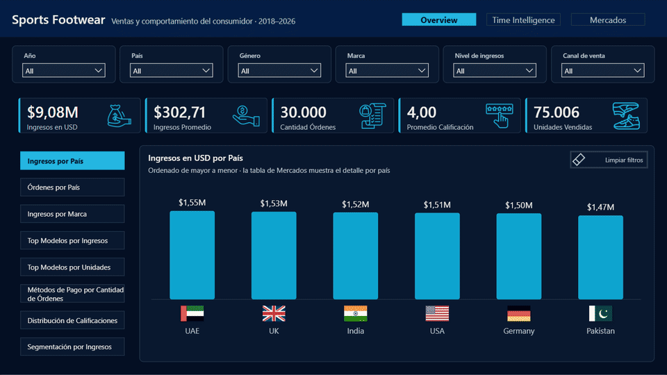
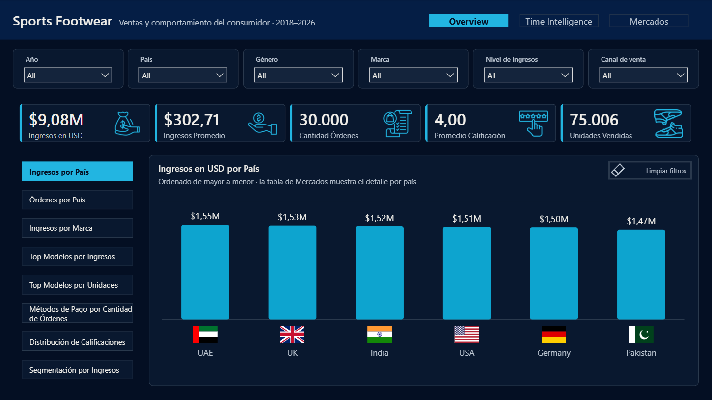
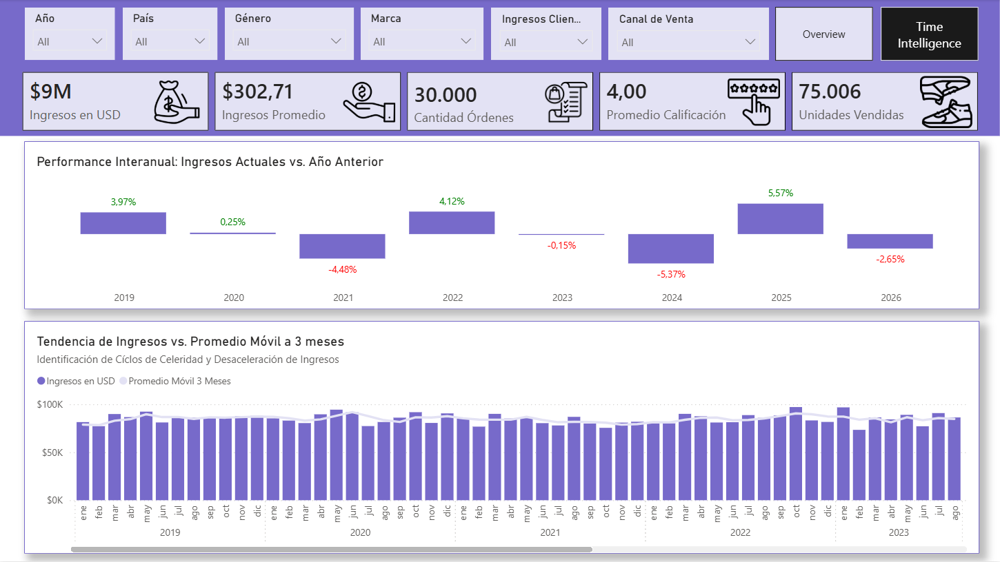
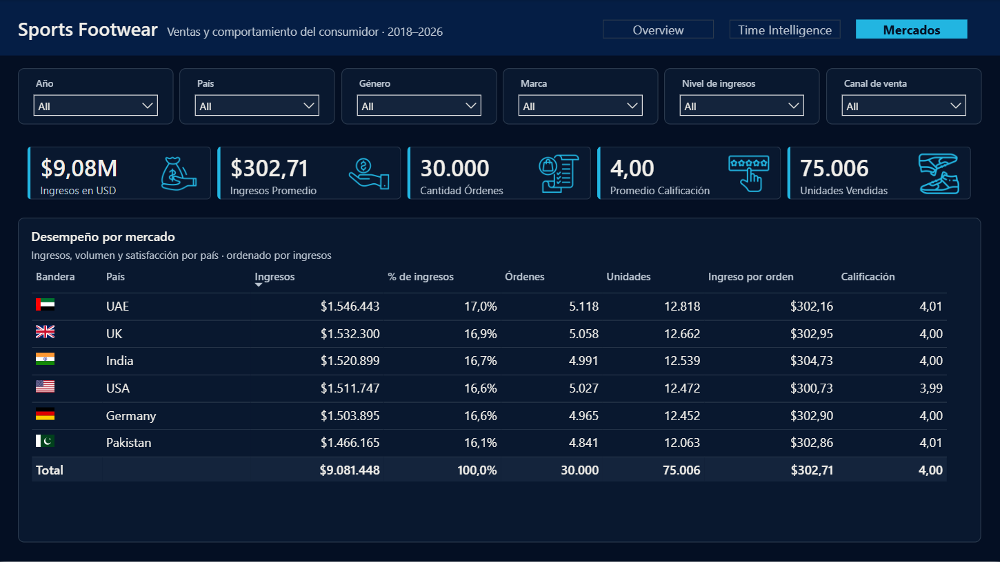
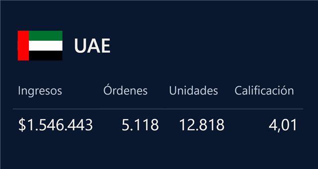
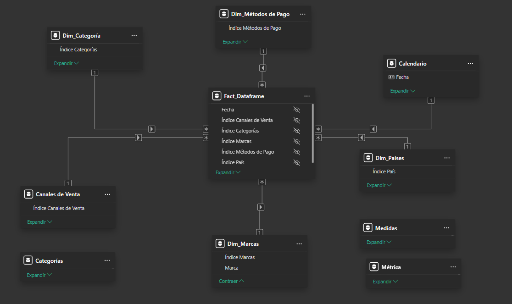

# Análisis de ventas de calzado deportivo y comportamiento del consumidor
<p>
  <a href="README.md"></a>
  <a href="README.es.md"></a>
</p>

Un análisis en Power BI de las ventas de calzado deportivo en seis países entre 2018 y 2026. El informe compara los ingresos por país, marca, categoría y segmento de clientes, sigue las tendencias interanuales y mensuales, y muestra cómo califican los clientes sus compras.

<p align="center">
  
</p>

<p align="center"><a href="docs/Preview.mp4">▶️ Ver el recorrido en calidad completa (MP4)</a></p>

## Dashboard







Al pasar el cursor sobre un país, en el gráfico de Overview o en la tabla de Mercados, se abre un tooltip con su bandera y sus métricas:



## Hallazgos principales

El dataset tiene 30.000 órdenes, 75.006 unidades y USD 9,08 M de ingresos, un promedio de USD 302,71 por orden.

- **Los ingresos se reparten de forma pareja entre países.** Emiratos Árabes Unidos lidera con USD 1,55 M y Pakistán es el más bajo con USD 1,47 M, una diferencia de 5,5%. Los países quedan en el mismo orden por ingresos que por unidades vendidas, así que ningún mercado paga precios notablemente más altos.
- **ASICS es la marca con más ingresos**, con USD 1,56 M, un 2,4% por encima de Nike. Adidas tiene los ingresos más bajos (USD 1,49 M) y la calificación promedio más baja, aunque por muy poco (3,99 contra 4,00 del total).
- **Los descuentos no agrandan la compra.** Las órdenes promedian unas 2,5 unidades en todos los niveles de descuento, de 0% a 30%. Como cada nivel de descuento tiene una cantidad parecida de órdenes, los ingresos caen de USD 1,72 M con 0% a USD 1,23 M con 30%.
- **Las ventas no dependen de unos pocos productos.** Los tres modelos con más ingresos (863, 855 y 604) suman el 0,56% de los ingresos, sobre un total de 899 modelos.
- **El 52,7% de las órdenes tiene calificación Buena o Muy buena**, y el 22,6% tiene Muy mala. La calificación promedio es 4,00 y casi no cambia por marca, categoría o género (de 3,99 a 4,01).
- **Cada nivel de ingreso del cliente aporta alrededor de un tercio de los ingresos.** Las órdenes online y en tienda física se reparten casi en partes iguales.
- **Los ingresos anuales son estables**, entre USD 0,97 M y 1,03 M, con variaciones interanuales de entre −5,4% (2024) y +5,6% (2025). No hay un pico estacional que se repita: el mejor mes cambia todos los años.

Su autor describe el dataset como datos realistas, pero incluye órdenes con fecha hasta diciembre de 2026, posteriores a su publicación en enero de 2026, así que al menos una parte es simulada. Sus distribuciones son casi uniformes, y por eso las diferencias entre segmentos son chicas. Los hallazgos describen este dataset, no un mercado real.

## Fuente de datos

[Sports Footwear Sales & Consumer Behavior](https://www.kaggle.com/datasets/aliiihussain/sports-footwear-sales-and-consumer-behavior), de Ali Hussain en Kaggle, publicado bajo CC0: Public Domain. El repositorio incluye una copia del CSV (versión 1) en `Data/`, y `scripts/download_dataset.py` lo vuelve a descargar desde Kaggle.

## Método

**Power Query.** Una única consulta de staging, `Ventas_Origen`, lee el CSV, define tipos explícitos, renombra las columnas al español y traduce los valores. Todas las demás tablas parten de ella, así que toda la limpieza está en un solo lugar.

- **Lectura independiente de la configuración regional.** Los tipos se definen con la cultura `en-US`, así que el punto decimal se lee bien con cualquier configuración regional.
- **Una función para todas las dimensiones.** Una función reutilizable, `fnCrearDimension`, arma cada dimensión con una clave subrogada.
- **Banderas de los países.** Una consulta `Banderas` guarda la bandera de cada país como imagen SVG incrustada, así el informe las muestra sin archivos externos.
- **Gráficos dibujados en DAX.** Los gráficos nativos de Power BI no pueden mostrar imágenes en el eje, así que los gráficos con banderas son SVG armados por medidas (`Gráfico por País Overview` y `Gráfico Ingresos por País`). Responden a los filtros de la página como cualquier otro visual.
- **Grupos de consultas.** Las consultas se agrupan en Parámetros, Funciones, Transformación, Dimensiones, Hechos y Medidas.

**Modelo.** Un esquema en estrella con una tabla de hechos a nivel de orden:

- **Hechos y dimensiones.** `Fact_Dataframe` tiene 30.000 filas y se relaciona de muchos a uno con cinco dimensiones: marcas, categorías, canales de venta, métodos de pago y países. También se relaciona con una tabla de fechas en DAX.
- **Tabla de fechas.** `Calendario` cubre años calendario completos para que las comparaciones con el mismo período del año anterior coincidan. La fecha/hora automática está desactivada.
- **Medidas en lugar de columnas.** Todos los totales son medidas, organizadas en carpetas de visualización dentro de la tabla `Medidas`. Las claves y las columnas de orden están ocultas, y los atributos numéricos, como el talle y la calificación, están configurados para no sumarse.
- **Bandas de satisfacción.** Las calificaciones se agrupan en Muy mala (menos de 3,5), Mala (de 3,5 a menos de 4), Buena (de 4 a menos de 4,5) y Muy buena (de 4,5 a 5).



**Medidas.**

- **Métricas base.** Ingresos, unidades, órdenes, ingreso promedio por orden y calificación promedio.
- **Interanual.** Ingresos del año anterior y la variación contra ellos, en valor absoluto y en porcentaje.
- **Promedio móvil de 3 meses.** Los ingresos mensuales promediados sobre los últimos tres meses. Se muestra solo a nivel de mes y una vez que hay tres meses completos de historia.

**Informe.**

- **Overview.** Tarjetas de KPI y segmentadores, más un gráfico de columnas controlado por dos parámetros de campo: `Métrica` elige qué medir y `Categorías` elige cómo agruparlo.
  - **Para usuarios de negocio.** Ocho botones de marcadores abren vistas predefinidas, como ingresos por país o distribución de calificaciones. Las dos vistas por país muestran un gráfico SVG con la bandera de cada país debajo de su barra.
  - **Para analistas.** Los segmentadores de los parámetros están ocultos por defecto; mostralos desde el panel Selección (`Métrica` y `Categorías`) para explorar cualquier métrica por cualquier categoría.
- **Time Intelligence.** Variación interanual de los ingresos, e ingresos mensuales contra el promedio móvil de 3 meses.
- **Mercados.** Un gráfico de ingresos con la bandera de cada país debajo de su barra, y una tabla de detalle con una fila por país: ingresos, participación en los ingresos, órdenes, unidades, ingreso por orden y calificación promedio.
- **Tooltip de país.** Una página de tooltip personalizada muestra el nombre y las métricas del elemento señalado, más su bandera cuando se trata de un país.
  - **Mercados.** La usa la tabla de detalle.
  - **Overview, vistas por país.** Como ahí el gráfico con banderas es una sola imagen, encima hay un gráfico de columnas nativo e invisible, con una columna por país, así que al pasar el cursor sobre una barra se abre el tooltip.

El diseño usa la paleta de la marca GlobalAIze: fondos azul marino, celeste para la serie principal y los elementos seleccionados, naranja para la segunda serie y rojo solo para las caídas. El informe está en español. [`docs/documentacion.md`](docs/documentacion.md) detalla los supuestos, las consultas, el modelo y los hallazgos.

## Archivos

- `Sports Footwear Sales & Consumer Behavior.pbix`: el informe como un único archivo de Power BI, con los datos cargados.
- `Sports Footwear Sales & Consumer Behavior.pbip`: proyecto de Power BI. Abre las carpetas del informe y del modelo semántico que están al lado.
- `Sports Footwear Sales & Consumer Behavior.Report/`: definición del informe.
- `Sports Footwear Sales & Consumer Behavior.SemanticModel/`: modelo semántico en TMDL, con el código de Power Query y las medidas DAX.
- `Data/`: CSV de origen.
- `scripts/`: script de descarga del dataset y sus dependencias.
- `docs/documentacion.md`: documentación del proyecto (en español).
- `Images/`: capturas del informe y diagrama del modelo.
- `Preview.gif`, `docs/Preview.mp4`: recorrido por el dashboard (el GIF está incrustado arriba).
- `LICENSE`: licencia MIT.

## Abrir el informe

Para ver el informe nada más, abrí `Sports Footwear Sales & Consumer Behavior.pbix` en Power BI Desktop. Ya trae los datos.

Para trabajar con los archivos del proyecto:

1. Cloná o descargá el repositorio.
2. Abrí `Sports Footwear Sales & Consumer Behavior.pbip` en Power BI Desktop.
3. Elegí **Actualizar**. El informe lee el CSV desde este repositorio en GitHub, así que no hace falta configurar nada. La primera vez, Power BI pregunta cómo acceder a raw.githubusercontent.com: elegí **Anónimo** y **Conectar**.

Para trabajar sin conexión, andá a **Transformar datos → Editar parámetros** y poné en `OrigenDatos` la ruta completa de `Data/global_sports_footwear_sales_2018_2026.csv` en tu computadora.

Para volver a descargar el dataset desde Kaggle:

```bash
pip install -r scripts/requirements.txt
python scripts/download_dataset.py
```

## Herramientas

Power BI Desktop, Power Query (M), DAX y Python.
