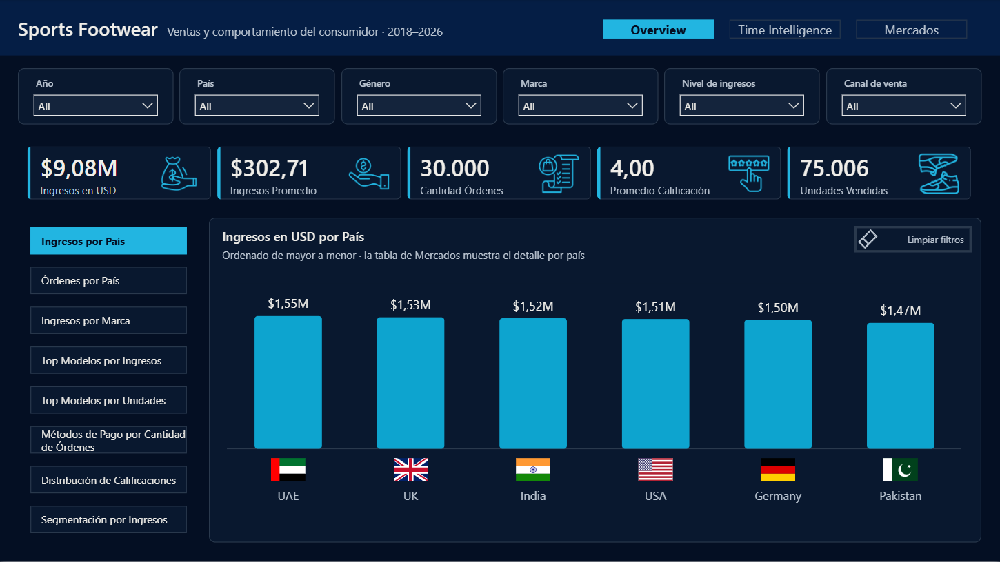
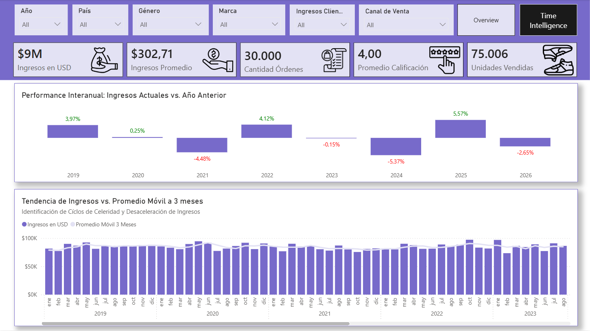
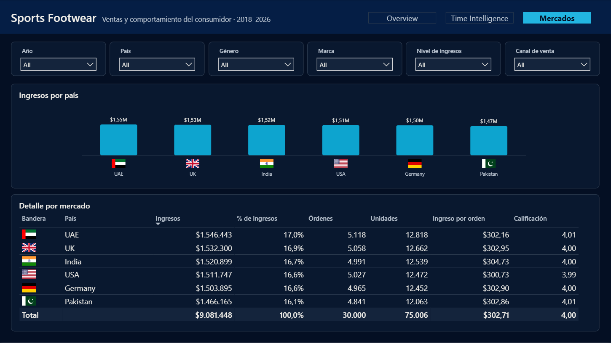
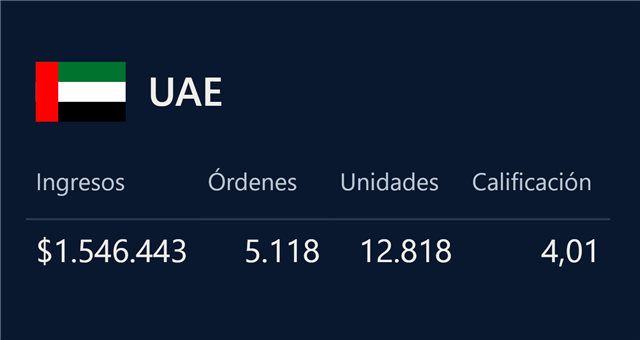
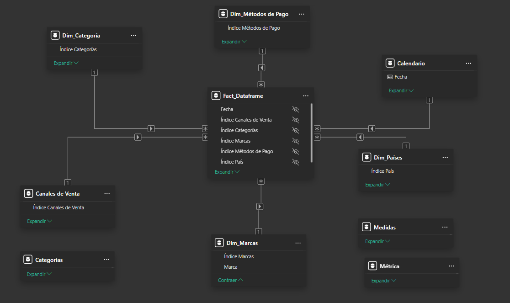

# Sports Footwear Sales and Consumer Behavior Analysis

A Power BI analysis of sports footwear sales across six countries from 2018 to 2026. The report compares revenue by country, brand, category, and customer segment, tracks year-over-year and monthly trends, and shows how customers rate their purchases. It was built as a technical challenge for a BI Developer / Analytics Engineer role.

## Dashboard







Hovering over a country in the Overview chart opens a tooltip with its flag and metrics:



## Key findings

The dataset has 30,000 orders, 75,006 units, and USD 9.08M in revenue, an average of USD 302.71 per order.

- **Revenue is spread evenly across countries.** The UAE leads with USD 1.55M and Pakistan is lowest with USD 1.47M, a 5.5% gap. Countries rank in the same order by revenue as by units sold, so no market pays noticeably higher prices.
- **ASICS is the top brand by revenue** at USD 1.56M, 2.4% ahead of Nike. Adidas has the lowest revenue (USD 1.49M) and the lowest average rating, though only slightly (3.99 against 4.00 overall).
- **Discounts don't increase basket size.** Orders average about 2.5 units at every discount level from 0% to 30%. Because each discount level has a similar number of orders, revenue falls from USD 1.72M at 0% to USD 1.23M at 30%.
- **Sales don't depend on a few products.** The three highest-revenue models (863, 855, and 604) make up 0.56% of revenue across 899 models.
- **52.7% of orders are rated Good or Very Good**, and 22.6% are rated Very Poor. The average rating is 4.00 and barely changes by brand, category, or gender (3.99 to 4.01).
- **Each customer income level brings in about a third of revenue.** Online and retail store orders are split almost evenly.
- **Annual revenue is stable** at USD 0.97M to 1.03M, with year-over-year changes between −5.4% (2024) and +5.6% (2025). There is no repeating seasonal peak: the best month changes every year.

The dataset is described by its author as realistic data, but it includes orders dated through December 2026, after its January 2026 publication date, so at least part of it is simulated. Its distributions are close to uniform, which is why the gaps between segments are small. The findings describe this dataset, not a real market.

## Data source

[Sports Footwear Sales & Consumer Behavior](https://www.kaggle.com/datasets/aliiihussain/sports-footwear-sales-and-consumer-behavior) by Ali Hussain on Kaggle, released under CC0: Public Domain. The repository includes a copy of the CSV (version 1) in `Data/`, and `scripts/download_dataset.py` downloads it again from Kaggle.

## Method

**Power Query.** One staging query, `Ventas_Origen`, reads the CSV, sets explicit types, renames columns to Spanish, and translates values. Every other table builds on it, so all the cleaning lives in one place.

- **Locale-independent parsing.** Types are set with the `en-US` culture, so decimal points are read correctly on any regional setting.
- **Shared dimension function.** A reusable function, `fnCrearDimension`, builds each dimension with a surrogate key.
- **Country flags.** A `Banderas` query holds each country's flag as an embedded SVG image, so the report shows them without any external files.
- **Chart drawn in DAX.** Native Power BI charts can't show images on the axis, so the flag chart on Mercados is an SVG built by the `Gráfico Ingresos por País` measure. It responds to the page filters like any other visual.
- **Query groups.** Queries are grouped into Parameters, Functions, Transformation, Dimensions, Fact, and Measures.

**Model.** A star schema with one order-level fact table:

- **Fact and dimensions.** `Fact_Dataframe` holds 30,000 rows and joins many-to-one to five dimensions: brands, categories, sales channels, payment methods, and countries. It also joins to a DAX date table.
- **Date table.** `Calendario` covers whole calendar years so that same-period-last-year comparisons line up. Auto date/time is turned off.
- **Measures over columns.** All totals are measures, organized in display folders in the `Medidas` table. Keys and sort columns are hidden, and numeric attributes such as size and rating are set not to sum.
- **Satisfaction bands.** Ratings are grouped into Very Poor (below 3.5), Poor (3.5 to under 4), Good (4 to under 4.5), and Very Good (4.5 to 5).



**Measures.**

- **Base metrics.** Revenue, units, orders, average revenue per order, and average rating.
- **Year-over-year.** Prior-year revenue and the change against it, absolute and percentage.
- **3-month moving average.** Monthly revenue averaged over the last three months, shown only at month level and once three full months of history exist.

**Report.**

- **Overview.** KPI cards and slicers, plus one column chart driven by two field parameters: `Métrica` chooses what to measure and `Categorías` chooses how to group it.
  - **For business users.** Eight bookmark buttons open predefined views, such as revenue by country or rating distribution.
  - **For analysts.** The parameter slicers are hidden by default; show them from the Selection pane (`Métrica` and `Categorías`) to explore any metric by any category.
- **Time Intelligence.** Year-over-year revenue change, and monthly revenue against the 3-month moving average.
- **Mercados.** A revenue chart with each country's flag under its bar, and a detail table with one row per country: revenue, share of revenue, orders, units, revenue per order, and average rating.
- **Country tooltip.** Hovering over a bar in the Overview chart shows a custom tooltip page with the item's name and metrics, plus the flag when the chart is grouped by country.

The design uses the GlobalAIze brand palette: navy surfaces, celeste for the main series and selected states, orange for the second series, and red only for declines. The report is in Spanish. [`docs/documentacion.md`](docs/documentacion.md) covers the assumptions, queries, model, and findings in more detail.

## Files

- `Sports Footwear Sales & Consumer Behavior.pbix`: the report as a single Power BI file, with data loaded.
- `Sports Footwear Sales & Consumer Behavior.pbip`: Power BI project. It opens the report and semantic model folders next to it.
- `Sports Footwear Sales & Consumer Behavior.Report/`: report definition.
- `Sports Footwear Sales & Consumer Behavior.SemanticModel/`: semantic model in TMDL, including the Power Query code and DAX measures.
- `Data/`: source CSV.
- `scripts/`: dataset download script and its requirements.
- `docs/documentacion.md`: project documentation (Spanish).
- `Images/`: report screenshots and model diagram.
- `LICENSE`: MIT License.

## Open the report

To just view the report, open `Sports Footwear Sales & Consumer Behavior.pbix` in Power BI Desktop. It already contains the data.

To work with the project files:

1. Clone or download the repository.
2. Open `Sports Footwear Sales & Consumer Behavior.pbip` in Power BI Desktop.
3. Select **Refresh**. The report reads the CSV from this repository on GitHub, so no setup is needed. The first time, Power BI asks how to access raw.githubusercontent.com: choose **Anonymous** and **Connect**.

To work offline, go to **Transform data → Edit parameters** and set `OrigenDatos` to the full path of `Data/global_sports_footwear_sales_2018_2026.csv` on your machine.

To download the dataset again from Kaggle:

```bash
pip install -r scripts/requirements.txt
python scripts/download_dataset.py
```

## Tools

Power BI Desktop, Power Query (M), DAX, and Python.
