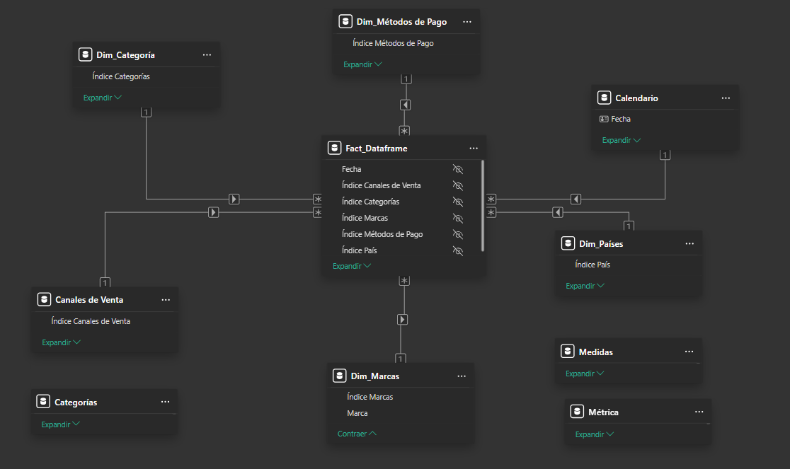

# Sports Footwear Sales & Consumer Behavior — Documentación

Informe de Power BI que analiza ventas, precios y satisfacción de clientes de calzado deportivo en seis países entre 2018 y 2026.

## Fuente de datos

- **Dataset:** [Sports Footwear Sales & Consumer Behavior](https://www.kaggle.com/datasets/aliiihussain/sports-footwear-sales-and-consumer-behavior), de Ali Hussain en Kaggle.
- **Licencia:** CC0: Public Domain.
- **Archivo:** `global_sports_footwear_sales_2018_2026.csv` (versión 1, publicada el 26 de enero de 2026). Tiene 30.000 órdenes y 18 columnas, sin valores vacíos ni órdenes duplicadas.
- **Copia en el repositorio:** `Data/`. El script `scripts/download_dataset.py` vuelve a descargarla desde Kaggle.

El autor describe los datos como "realistas". Incluyen órdenes hasta el 31 de diciembre de 2026, posteriores a la fecha de publicación, así que al menos parte del dataset es simulado. Las distribuciones son casi uniformes, por lo que las diferencias entre segmentos son chicas. Los hallazgos describen este dataset, no un mercado real.

## Supuestos

- **Métrica principal:** ingresos en USD. Resume el desempeño del negocio y se puede comparar entre cualquier categoría.
- **Fecha de venta:** la fecha de la orden se toma como el momento de la venta y del reconocimiento del ingreso. El dataset no incluye entregas ni devoluciones.
- **Bandas de satisfacción:** la calificación del cliente (de 3,0 a 5,0) se agrupa en cuatro bandas:

  | Banda | Rango |
  |---|---|
  | Muy mala | menor a 3,5 |
  | Mala | de 3,5 a menos de 4 |
  | Buena | de 4 a menos de 4,5 |
  | Muy buena | 4,5 o más |

  La calificación mínima del dataset es 3,0, por eso la banda más baja empieza ahí.

## Power Query

Las consultas están organizadas en grupos:

| Grupo | Consulta | Función |
|---|---|---|
| Parámetros | `OrigenDatos` | URL o ruta local del CSV. Por defecto apunta a la copia del repositorio en GitHub. |
| Funciones | `fnCrearDimension` | Arma una dimensión con los valores distintos de una columna, ordenados y con clave entera. |
| Transformación | `Banderas` | Bandera de cada país como SVG incrustado, en texto (para tablas) y en base64 (para el gráfico SVG). Se une a `Dim_Países`. |
| Transformación | `Ventas_Origen` | Lee el CSV, define tipos, renombra columnas al español y traduce valores. No se carga al modelo. |
| Dimensiones | `Dim_Marcas`, `Dim_Categoría`, `Canales de Venta`, `Dim_Métodos de Pago`, `Dim_Países` | Una llamada a `fnCrearDimension` cada una. |
| Hechos | `Fact_Dataframe` | Reemplaza cada atributo por la clave de su dimensión. |
| Medidas | `Medidas` | Tabla vacía que contiene las medidas. |

Decisiones principales:

- **Tipos con cultura `en-US`:** los tipos se definen con cultura `en-US` porque el CSV usa punto decimal. Así los precios, ingresos y calificaciones se leen bien con cualquier configuración regional.
- **Traducción exacta de valores:** los valores se traducen por coincidencia exacta (por ejemplo, `Men` → `Masculino`). Un reemplazo de subcadenas podría alterar otros valores.
- **Modelo como número:** el modelo se guarda como número (`Model-370` → `370`) y el descuento como proporción (`15` → `0,15`).
- **Un solo origen:** todas las tablas parten de `Ventas_Origen`, así que la limpieza está en un solo lugar.

## Modelo de datos

Esquema estrella con una tabla de hechos a nivel de orden:

| Tabla | Tipo | Filas | Clave |
|---|---|---|---|
| `Fact_Dataframe` | Hechos | 30.000 | `ID Orden` |
| `Dim_Marcas` | Dimensión | 6 | `Índice Marcas` |
| `Dim_Categoría` | Dimensión | 5 | `Índice Categorías` |
| `Canales de Venta` | Dimensión | 2 | `Índice Canales de Venta` |
| `Dim_Métodos de Pago` | Dimensión | 4 | `Índice Métodos de Pago` |
| `Dim_Países` | Dimensión | 6 | `Índice País` |
| `Calendario` | Fechas (DAX) | 3.287 | `Fecha` |
| `Medidas` | Medidas | — | — |
| `Métrica`, `Categorías` | Parámetros de campo | 5 y 12 | — |

- **Relaciones:** todas son de muchos a uno, desde `Fact_Dataframe` hacia cada dimensión, con filtro en una sola dirección.
- **Calendario:** se crea con `CALENDAR()` desde el 1 de enero del primer año con ventas hasta el 31 de diciembre del último. Así cubre años completos para las comparaciones interanuales. Se usa en lugar de `CALENDARAUTO()` para controlar el rango, y la fecha/hora automática está desactivada.
- **Columnas:** las claves y las columnas de orden están ocultas. Las columnas numéricas descriptivas (modelo, talle, precios, calificación) no se resumen automáticamente. Los totales se calculan siempre con medidas.
- **Columna calculada:** la única es `Categoría Calificación`, que asigna cada orden a su banda de satisfacción.

## Medidas

| Carpeta | Medidas |
|---|---|
| Métricas Base | `Ingresos en USD`, `Unidades Vendidas`, `Cantidad Órdenes`, `Ingresos Promedio` (por orden), `Promedio Calificación de Cliente`, `% Ingresos por País` |
| Métricas Dinámicas | `Métrica Dinámica Valor`, `% del Total Visible` |
| Time Intelligence | `Ingresos LY`, `Ingresos YoY`, `YoY % Ingresos`, `Promedio Móvil 3 Meses` |
| Cosméticos | colores condicionales, título dinámico, máximo del eje Y y el gráfico SVG con banderas |
| Tooltip | `Bandera Seleccionada`, `Elemento Seleccionado` |

- **`Promedio Móvil 3 Meses`:** promedia los ingresos mensuales de los últimos tres meses. Solo devuelve un valor a nivel de mes y cuando existen tres meses completos de historia.
- **`YoY % Ingresos` e `Ingresos YoY`:** quedan vacías cuando no hay año anterior.

## Diseño del informe

- **Overview:** tarjetas de KPI, filtros por año, país, género, marca, nivel de ingresos y canal, y un gráfico de columnas. El gráfico se controla con dos parámetros de campo: `Métrica` (qué medir) y `Categorías` (por qué agrupar).
  - Los botones de marcadores de la izquierda llevan a ocho vistas predefinidas, como ingresos por país o distribución de calificaciones.
  - Las dos vistas por país ("Ingresos por País" y "Órdenes por País") muestran un gráfico SVG con la bandera bajo cada barra, armado por la medida `Gráfico por País Overview`. Las otras seis usan el gráfico nativo.
  - Los segmentadores de los parámetros están ocultos para el usuario de negocio. Los analistas pueden mostrarlos desde el panel de selección, con los elementos "Métrica" y "Categorías".
- **Time Intelligence:** variación interanual de ingresos, e ingresos mensuales con el promedio móvil de tres meses.
- **Mercados:** gráfico de ingresos con la bandera de cada país bajo su barra, y tabla de detalle con una fila por país (ingresos, participación, órdenes, unidades, ingreso por orden y calificación promedio).
  - Los gráficos nativos de Power BI no admiten imágenes en el eje. Por eso este gráfico es un SVG que arma la medida `Gráfico Ingresos por País` y se muestra como imagen en una tabla. Responde a los filtros de la página.
- **Tooltip País:** página de tooltip oculta, asignada a la tabla de Mercados y al gráfico nativo de Overview. Muestra el nombre del elemento señalado (`Elemento Seleccionado`) y sus métricas, y la bandera (`Bandera Seleccionada`) cuando el elemento es un país.
- **Diseño:** usa la paleta de la marca GlobalAIze.
  - **Fondos:** azul marino.
  - **Celeste:** la serie principal y los elementos seleccionados.
  - **Naranja:** la segunda serie.
  - **Rojo:** solo para caídas.
  - **Bandas de satisfacción:** van del rojo (Muy mala) al celeste (Muy buena).
  - **Tema del informe:** todos los colores están en el tema, en `StaticResources/RegisteredResources/`.

## Hallazgos

Total del período: USD 9,08 millones en 30.000 órdenes y 75.006 unidades, con un ingreso promedio de USD 302,71 por orden.

1. **Los países tienen ingresos muy parecidos.** Emiratos Árabes Unidos lidera con USD 1,55 M y Pakistán es el más bajo con USD 1,47 M, una diferencia de 5,5 %. El orden por ingresos es el mismo que por unidades vendidas: ningún país tiene precios más altos que el resto.
2. **ASICS es la marca con más ingresos** (USD 1,56 M), 2,4 % por encima de Nike. Adidas tiene los ingresos más bajos (USD 1,49 M) y también la calificación promedio más baja, aunque la diferencia es mínima (3,99 contra 4,00 del total).
3. **Lifestyle es la categoría con más ingresos** (USD 1,84 M) y Gym la más baja (USD 1,77 M), una diferencia de 4,1 %.
4. **Los descuentos no aumentan las unidades por orden.** Las órdenes promedian unas 2,5 unidades con cualquier descuento, de 0 % a 30 %. Como cada nivel de descuento tiene una cantidad parecida de órdenes, los ingresos caen de USD 1,72 M sin descuento a USD 1,23 M con 30 %.
5. **No hay dependencia de pocos modelos.** Los tres modelos con más ingresos (863, 855 y 604) suman 0,56 % del total entre 899 modelos. El 863 también es el que más unidades vende.
6. **El 52,7 % de las órdenes tiene calificación Buena o Muy buena**, y el 22,6 % Muy mala. El promedio es 4,00 y casi no cambia por marca, categoría o género (entre 3,99 y 4,01).
7. **Los tres niveles de ingreso del cliente aportan alrededor de un tercio cada uno** (USD 3,04 M bajo, USD 3,04 M alto y USD 3,00 M medio).
8. **La transferencia bancaria es el método de pago más usado** (25,6 % de las órdenes) y el efectivo el menos usado (24,4 %). Online y tienda física se reparten las órdenes casi en partes iguales.
9. **Los ingresos anuales son estables**, entre USD 0,97 M y USD 1,03 M. La variación interanual va de −5,4 % (2024) a +5,6 % (2025).
10. **No hay un pico estacional que se repita.** El mes de mayores ingresos cambia cada año. Octubre es el mes más alto sumando todos los años, pero por poco (8,6 % de los ingresos, contra 8,3 % de un mes promedio).
